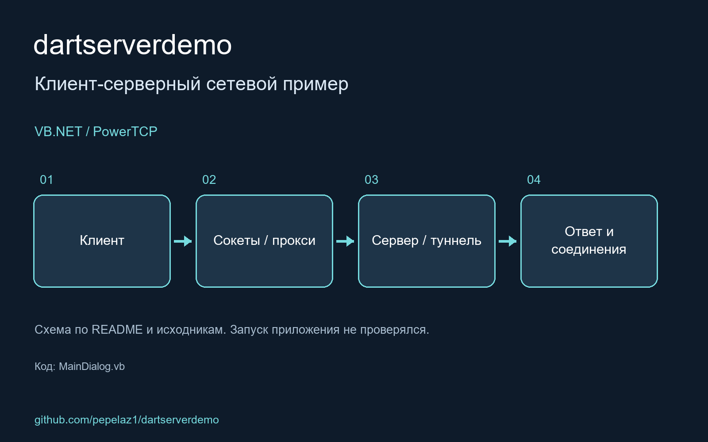

 VB.NET client/server application based on Power TCP components (http://www.dart.com/purchase.aspx?pl=PowerTCP)

<!-- portfolio-visual:start -->
## Схема работы

Схема подготовлена по README и исходному коду. Запуск приложения не проверялся.
<!-- portfolio-visual:end -->
